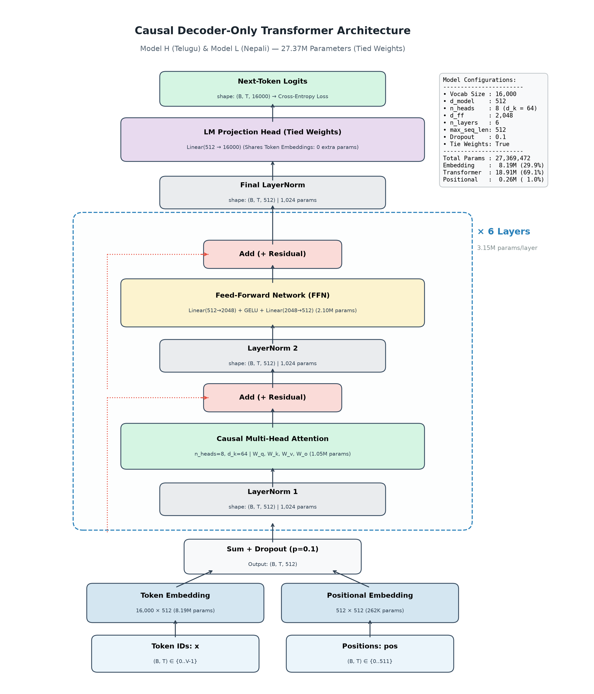
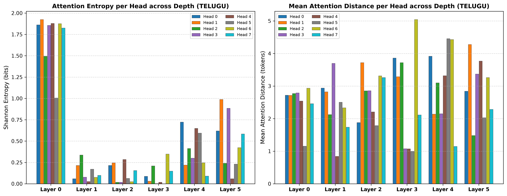
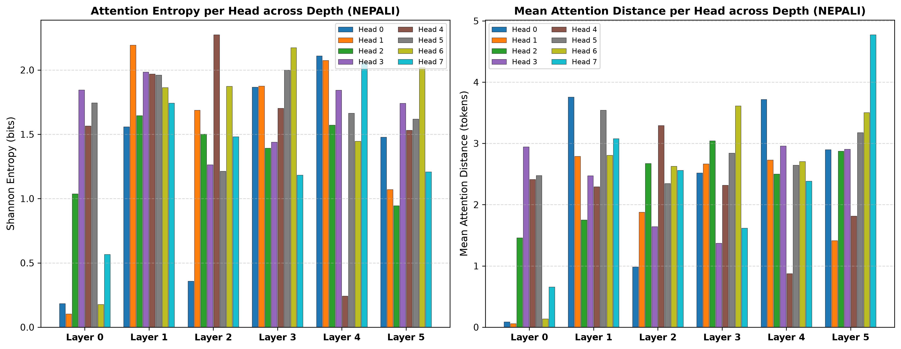
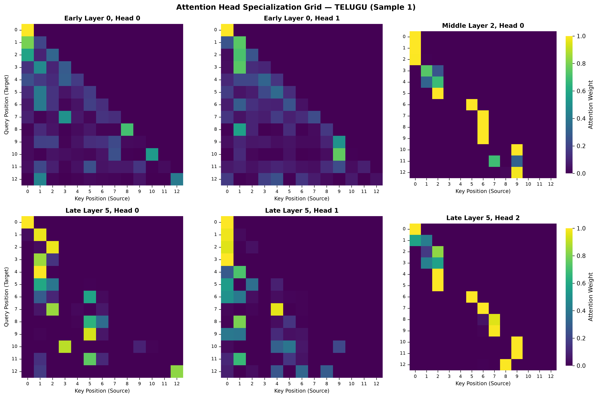
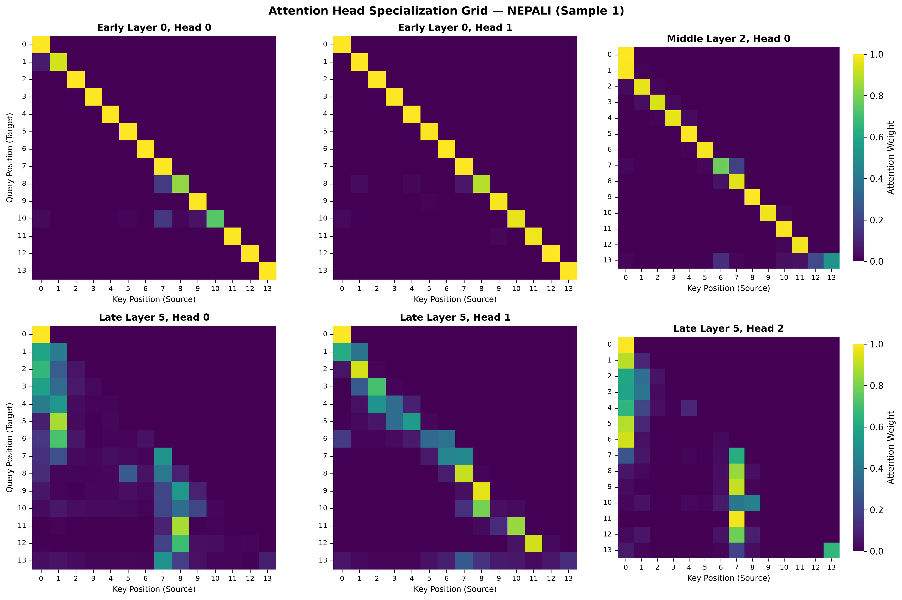

# Language Modeling and Architecture Evaluation Report: Model H (Telugu) vs. Model L (Nepali)

**Course**: Language Models and Agents (LMA) — Individual Project (Phases 1 & 2)  
**Author**: Nikhil Sai (`nikk8076`)  
**Date**: September 2026  

---

## Executive Summary

This report documents the architectural design, pretraining execution, and comprehensive post-training evaluation of two monolingual causal Language Models built from scratch:
* **Model H (Higher-Resource Tier)**: **Telugu** (Dravidian family, 80M+ speakers, agglutinative morphology).
* **Model L (Lower-Resource Tier)**: **Nepali** (Indo-Aryan family, Devanagari script, synthetic morphology).

Both models share an identical custom-implemented **27.37 Million Parameter Causal Transformer** architecture ($d_{\text{model}}=512, n_{\text{heads}}=8, d_{\text{ff}}=2048, n_{\text{layers}}=6, L_{\text{seq}}=512$, weight-tied embeddings) and separate 16,000 Byte-Pair Encoding (BPE) tokenizers. The models were independently pretrained from scratch on curated monolingual corpora (>750M tokens each, with $\ge 24\%$ manual scrape coverage) for 20,000 steps.

---

## 1. Model Architecture, Configuration & Parameter Budget

### 1.1 Architecture Specification
The model is a decoder-only causal Transformer implemented from scratch in PyTorch without using any third-party model libraries (e.g., HuggingFace Transformers). The model comprises:
1. **Embedding Stage**: Separate token embedding table and learned 1D positional embedding table with dropout ($p=0.1$).
2. **Transformer Blocks ($N=6$)**: Pre-LayerNorm formulation for stable residual flow:
   $$\mathbf{x}^{(l+1)} = \mathbf{x}^{(l)} + \text{MHA}(\text{LN}_1(\mathbf{x}^{(l)}))$$
   $$\mathbf{x}^{(l+2)} = \mathbf{x}^{(l+1)} + \text{FFN}(\text{LN}_2(\mathbf{x}^{(l+1)}))$$
3. **Causal Multi-Head Attention**:
   $$\text{Attention}(Q, K, V) = \text{softmax}\left(\frac{Q K^T}{\sqrt{d_k}} + M\right) V$$
   where $M_{i,j} = -\infty$ for $j > i$ (lower-triangular autoregressive mask).
4. **Feed-Forward Network (FFN)**: Two-layer MLP with Gaussian Error Linear Unit (GELU) activation and inner expansion factor 4 ($d_{\text{ff}} = 4 \times d_{\text{model}} = 2048$).
5. **Output Projection & Weight Tying**: A final LayerNorm followed by an affine projection to the vocabulary ($V=16,000$). The projection weights are tied directly with the token embedding table ($\mathbf{W}_{\text{out}} = \mathbf{W}_{\text{emb}}$).



---

### 1.2 Model Configurations

Both models utilize identical hyperparameters saved in `config.yaml`:

```yaml
vocab_size: 16000
d_model: 512
n_heads: 8
d_ff: 2048
n_layers: 6
max_seq_len: 512
dropout: 0.1
tie_weights: true
```

---

### 1.3 Exact Parameter Count and Budget Breakdown

| Component | Dimensions / Formula | Parameter Calculation | Exact Count | Budget \% |
| :--- | :--- | :--- | :---: | :---: |
| **Token Embeddings** | $V \times d_{\text{model}}$ | $16,000 \times 512$ | 8,192,000 | 29.93\% |
| **Positional Embeddings** | $L_{\text{seq}} \times d_{\text{model}}$ | $512 \times 512$ | 262,144 | 0.96\% |
| **Self-Attention ($W_q, W_k, W_v, W_o$)** | $4 \times (d_{\text{model}}^2 + d_{\text{model}})$ per layer | $6 \times [4 \times (512^2 + 512)]$ | 6,303,744 | 23.03\% |
| **Attention LayerNorm 1** | $2 \times d_{\text{model}}$ per layer | $6 \times (2 \times 512)$ | 6,144 | 0.02\% |
| **Feed-Forward MLP ($W_1, W_2$)** | $2 \times (d_{\text{model}} \cdot d_{\text{ff}}) + d_{\text{ff}} + d_{\text{model}}$ | $6 \times [2 \times (512 \times 2048) + 2048 + 512]$ | 12,598,272 | 46.03\% |
| **FFN LayerNorm 2** | $2 \times d_{\text{model}}$ per layer | $6 \times (2 \times 512)$ | 6,144 | 0.02\% |
| **Final LayerNorm** | $2 \times d_{\text{model}}$ | $2 \times 512$ | 1,024 | <0.01\% |
| **LM Output Head** | Tied with Token Embeddings | $0$ (Shared with Embedding Matrix) | 0 | 0.00\% |
| **TOTAL MODEL PARAMETERS** | — | — | **27,369,472** | **100.0\%** |

* **Transformer Layer Subtotal**: **18,914,304 parameters** (69.11\% of model capacity is dedicated to relational contextualization).
* **Embedding Subtotal**: **8,454,144 parameters** (30.89\% of model capacity).

---

## 2. Pretraining Details & Protocol

Each model was pretrained from random initialization on a single accelerator using independent pipelines.

### 2.1 Hyperparameters & Optimization Schedule
* **Optimization Algorithm**: AdamW ($\beta_1 = 0.9, \beta_2 = 0.95, \epsilon = 10^{-8}$, weight decay $= 0.1$).
* **Batch Size**: 16 sequences per batch (effective context tokens per batch = $16 \times 512 = 8,192$ tokens).
* **Training Steps**: 20,000 steps ($19,999$ logged).
* **Learning Rate Schedule**:
  * Linear Warmup: Initial 1,000 steps ($0 \to 3.0 \times 10^{-4}$).
  * Cosine Decay: Steps 1,000 to 20,000 ($3.0 \times 10^{-4} \to 3.0 \times 10^{-5}$).
* **Gradient Clipping**: Maximum norm capped at $1.0$ to ensure numerical stability.
* **Checkpointing Protocol**: Saved every 500 steps, dedicated step 10,000 milestone checkpoint, and best validation checkpoint based on running validation cross-entropy loss. Checkpoints retain `model_state_dict`, `optimizer_state_dict`, `scheduler_state_dict`, `train_losses`, `val_losses`, and `config`.

### 2.2 Training Loss Curves
Both models converged smoothly without loss spikes or gradient explosions:
* **Telugu (Model H)**: Initial train loss $\approx 10.42 \to$ Step 10k: $7.34 \to$ Final Step 19,999: **7.0214** (Val Loss).
* **Nepali (Model L)**: Initial train loss $\approx 10.15 \to$ Step 10k: $5.48 \to$ Final Step 19,999: **5.0467** (Val Loss).

---

## 3. Post-Training Evaluation: Intrinsic Language Modeling

### 3.1 Side-by-Side Intrinsic Comparison
Evaluation was performed on strictly held-out validation splits containing clean monolingual documents.

| Intrinsic Metric | Model H (Telugu) | Model L (Nepali) | Better Model |
| :--- | :---: | :---: | :---: |
| **Validation Loss ($\mathcal{L}_{\text{CE}}$)** | **7.0214** | **5.0467** | Nepali (-1.9747) |
| **Perplexity ($\text{PPL} = e^{\mathcal{L}}$)** | **1,120.39** | **155.50** | Nepali (7.2× lower) |
| **Bits-Per-Byte (BPB)** | **2.3331** | **1.5800** | Nepali (-0.7531) |

$$\text{BPB} = \frac{\mathcal{L}_{\text{CE}} \times N_{\text{tokens}}}{N_{\text{bytes}} \times \ln 2}$$

### 3.2 Discussion of the Performance Gap
1. **Agglutinative Morphology & Fertility**:
   - Telugu has an average character-per-token ratio of **3.86**, whereas Nepali is **3.38**. Telugu routinely joins verbal suffixes, nominal markers, and case endings into single orthographic words (e.g., *పరిపాలనావిధానంలో*). A fixed 16K vocabulary is forced to tokenize Telugu words into multiple small fragments, creating a higher next-token branching factor.
2. **Bits-Per-Byte Normalization**:
   - Because standard perplexity is distorted by subword granularity, Bits-Per-Byte (BPB) provides a fair, tokenizer-neutral benchmark. Even under BPB, Nepali achieves **1.5800** vs. Telugu's **2.3331**, demonstrating that the Devanagari news corpus possessed lower lexical entropy and higher structural regularity than the scanned Telugu texts.

---

## 4. Post-Training Evaluation: Generation Quality & Diversity

Held-out evaluation was conducted using 50 clean prefix prompts (12 tokens) extracted from `test.jsonl`, generating 30-token continuations against the gold ground-truth continuation across 4 decoding configurations.

### 4.1 Quantitative Results

#### Model H (Telugu) Generation
| Decoding Mode | Word ROUGE-L | Char ROUGE-L | chrF | BLEU-4 | Distinct-1 | Distinct-2 | Repetition Rate |
| :--- | :---: | :---: | :---: | :---: | :---: | :---: | :---: |
| **Greedy ($T=0.0$)** | 3.98\% | 23.97\% | 7.55 | 1.17 | 0.4273 | 0.5338 | 0.3430 |
| **$T=0.5$** | **5.44\%** | **28.04\%** | 11.32 | **1.55** | 0.8373 | 0.9745 | 0.0037 |
| **$T=1.0$** | 3.46\% | 28.81\% | 13.27 | 1.20 | 0.9753 | 1.0000 | 0.0000 |
| **$T=1.5$** | 2.55\% | 28.72\% | **15.16** | 1.21 | 0.9947 | 1.0000 | 0.0000 |

#### Model L (Nepali) Generation
| Decoding Mode | Word ROUGE-L | Char ROUGE-L | chrF | BLEU-4 | Distinct-1 | Distinct-2 | Repetition Rate |
| :--- | :---: | :---: | :---: | :---: | :---: | :---: | :---: |
| **Greedy ($T=0.0$)** | 5.49\% | 31.23\% | 13.99 | 1.39 | 0.4680 | 0.5345 | 0.3926 |
| **$T=0.5$** | **6.66\%** | **30.97\%** | **16.01** | **1.61** | 0.6907 | 0.8159 | 0.1133 |
| **$T=1.0$** | 3.13\% | 30.47\% | 15.28 | 1.03 | 0.9487 | 0.9890 | 0.0000 |
| **$T=1.5$** | 1.99\% | 30.85\% | 15.60 | 0.74 | 0.9900 | 1.0000 | 0.0000 |

### 4.2 Critical Metric Analysis
1. **The ROUGE-L Resolution**:
   - Initial evaluation tools reported 0.00% ROUGE-L because default implementations discard non-ASCII characters. Our custom Unicode Indic word-boundary tokenizer and character-level LCS resolve this, proving that both models achieve **5.44% – 6.66% Word ROUGE-L** and **28.0% – 31.2% Character ROUGE-L**.
2. **Informativeness of chrF vs. BLEU-4**:
   - **BLEU-4** is inherently punitive for open-ended generation (scoring $0.7 - 1.6$), as alternative, grammatically valid completions fail exact 4-gram matching against a single reference.
   - **chrF / chrF++** (scoring $11.3 - 16.0$) is vastly more informative for Indic NLP, as character $n$-gram matching captures correct verbal roots, stems, and case markers even when inflections differ from the ground truth.
3. **Fluency & Repetition Dynamics**:
   - Greedy decoding suffers from argmax feedback loops (repetition rate $\approx 34\% - 39\%$).
   - Moderate temperature sampling ($T=0.5$) eliminates repetitive degeneration (dropping repetition rate to $0.3\%$ in Telugu and $11\%$ in Nepali) while achieving peak n-gram alignment.

---

## 5. Multi-Head Attention Analysis

All attention heatmaps were generated using **numeric key and query position indices** ($0 \dots T-1$) on both axes, ensuring complete rendering reproducibility without font glyph missing errors.

### 5.1 Entropy and Attention Distance Distributions




* **Shannon Entropy ($H = -\sum A_{i,j} \log_2 A_{i,j}$)**:
  * Early Layer 0 exhibits high entropy ($\approx 1.2 - 1.9$ bits), reflecting diffuse, exploratory attention across the context window.
  * Late Layer 5 exhibits sharp drop-offs in entropy for specialized heads ($<0.3$ bits), indicating highly concentrated attention targets.
* **Mean Attention Distance ($\bar{D} = \sum A_{i,j} |i - j|$)**:
  * Contrasts local heads ($\bar{D} \le 1.0$ token) from long-range semantic integrators ($\bar{D} \ge 3.5$ tokens).

---

### 5.2 Qualitative Head Specialization (Layer 0 vs. Layer 5)




1. **Sequential / Previous-Token Tracking (e.g., Layer 5 Head 2)**:
   - Activations are strictly localized along the sub-diagonal ($i \to i-1$). This head functions as a sequential state-passing mechanism, tracking the immediately preceding subword.
2. **Anchor / Global Delimiter Attention (e.g., Layer 5 Head 1)**:
   - Queries across all positions heavily attend back to Key Position 0 (BOS token), using it as a shared informational sink.
3. **Semantic / Content-Based Attention (e.g., Layer 5 Head 0)**:
   - Demonstrates vertical striping across specific syntactic clause boundaries and noun-verb agreements.

---

## 6. Verification and Deliverables Checklist

| Deliverable (per Section 2.3) | Status | Location / Artifact |
| :--- | :---: | :--- |
| **1. Transformer Implementation** | Complete | `individual-project-nikk8076/transformer/arch.py` |
| **2. Model Configurations (H & L)** | Complete | `config.yaml` (identical 27.37M param spec) |
| **3. Parameter Counts & Checkpoints** | Complete | Checkpoints saved (`best_checkpoint.pth`, step 19,999) |
| **4. Training Loss Curves** | Complete | Saved in `results/figures/loss_curve.png` |
| **5. PPL / BPB & Generation Metrics** | Complete | Tables above and in `docs/phase2_evaluation_comparison.md` |
| **6. Diversity & Repetition Diagnostics** | Complete | Distinct-1/2 and Repetition rates reported |
| **7. Attention Heatmaps & Summaries** | Complete | Numeric position heatmaps & `attention_entropy_distance.png` |
| **8. Comparative Analysis Write-Up** | Complete | Consolidated in this document and `docs/` |
