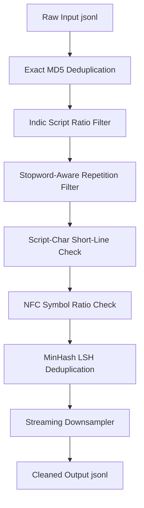

# Retention-Focused Data Cleaning Pipeline

This document explains the data cleaning, quality-filtering, and deduplication pipeline implemented for the Nepali and Telugu monolingual corpora.

---

## 1. Pipeline Overview

Indic languages (Devanagari and Telugu) use phonetic syllabaries where base consonants are combined with vowel diacritics (matras) and ligatures. Conventional web-crawled text-cleaning heuristics (built for English/Latin scripts) often degrade Indic corpora by misclassifying combining diacritics as special symbols or noise, discarding large blocks of grammatically valid text. 

Our pipeline is engineered to maximize vocabulary retention while stripping structural markup, duplicates, and non-target script fragments.

---

## 2. Core Processing Steps

The pipeline is implemented sequentially inside `clean.ipynb` using a streaming architecture to keep RAM footprint low:

### Step 1: Exact MD5 Deduplication
* **Goal**: Discard identical duplicate files early.
* **Mechanism**: Computes a fast MD5 hash of the raw document text. If the hash has been seen, the document is immediately dropped.

### Step 2: Indic Script Ratio Filter
* **Goal**: Remove documents that are written in foreign languages (English, Chinese, Cyrillic) or contain corrupted encoding.
* **Mechanism**: Counts the number of native Indic characters (Devanagari for Nepali, Telugu characters for Telugu) vs. total characters. Documents are kept if:
  $$\text{Script Ratio} = \frac{\text{Count(Native Script Characters)}}{\text{Total Characters}} \ge 45\%$$

### Step 3: Stopword-Aware Repetition Filter
* **Goal**: Detect and remove spam, repeating links, or boilerplate layout text without discarding valid repeating grammatical particles.
* **Mechanism**: Word-level repetition is checked. Standard pipelines drop text if a single word accounts for $>20\%$ of the document. We modified this to **skip common stopwords and grammatical postpositions** (e.g., Devanagari: *की*, *को*, *र*; Telugu: *ని*, *లో*, *మరియు*) during the check, ensuring grammatical repetition does not trigger document deletion.

### Step 4: Script-Char Short-Line Validation
* **Goal**: Remove short noise fragments (navigational headers, page numbers, links, dates) while preserving short valid text (dictionary definitions, classical poetry, list items).
* **Mechanism**: Instead of dropping lines based on a blunt word-count threshold, lines are preserved if they contain **at least one valid script character** corresponding to the target language.

### Step 5: NFC Symbol Ratio Check
* **Goal**: Remove encoding garbage, mathematical tables, and structural code.
* **Mechanism**: Normalizes text to Unicode NFC (Normalization Form Canonical Composition). We adjusted the symbol threshold to a relaxed $0.40$ (i.e. symbols can occupy up to $40\%$ of the document length) and registered Indic character ranges as alphabetic letters so they are not misclassified as symbol marks.

### Step 6: MinHash LSH Deduplication
* **Goal**: Remove near-duplicate documents (syndicated news, identical pages with different headers, boilerplate layouts).
* **Mechanism**: Computes MinHash signatures (using 128 hash functions) and groups them using Locality Sensitive Hashing (LSH) with a Jaccard threshold of $0.85$. If a document is clustered with an existing one, it is discarded.

### Step 7: Streaming Downsampler
* **Goal**: Fit the target word cap ($400$ Million words) and generate train/val/test splits without loading files into RAM.
* **Mechanism**: Runs a two-pass streaming sampler that counts manual words, computes selection probability for public/downloaded sources, samples them randomly line-by-line, and splits the final shrunken files into $90/5/5$ subsets.

---

## 3. Language-Specific Configurations

| Configuration | Devanagari (Nepali) | Telugu |
| :--- | :--- | :--- |
| **Allowed Unicode Range** | `\u0900-\u097F` (Devanagari) | `\u0C00-\u0C7F` (Telugu) |
| **Additional Allowed Marks** | `।` (Single Danda), `॥` (Double Danda) | Standard punctuation only |
| **Custom Stopwords Ignored** | *र, को, का, की, मा, र, थप, छ, छन, हुन्* | *ని, లో, మరియు, ఉన్న, ఈ, ఆ, కు, కి* |
| **Language Ratio Keep Threshold** | $\ge 45\%$ | $\ge 45\%$ |
| **NFC Symbol Ratio** | $< 0.40$ | $< 0.40$ |
